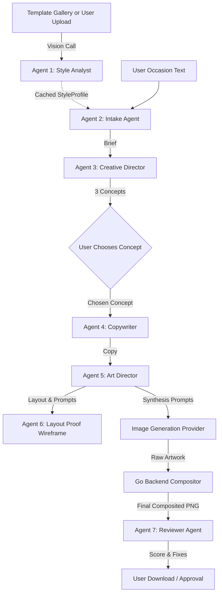

# ARMSS Poster Studio — Complete AI Pipeline Architecture, Token Sizing & Cost Analysis Dossier

> **Purpose of this Document:**
> This document provides a complete, granular architectural and financial specification of the **ARMSS Poster Studio** application. It is designed to be fed into any modern Large Language Model (e.g. Claude 3.5 Sonnet, GPT-4o, Gemini 1.5 Pro, DeepSeek V3) to analyze API costs, model performance, token economics, cloud infrastructure overhead, and recommended pricing/subscription tiers.

---

## 1. Executive Summary & Problem Statement

**ARMSS Poster Studio** is an automated marketing design engine built for ARMSS Employment Solutions and its associated organizations. It enables marketing staff, recruiters, and administrative users to turn a single short text prompt (e.g., *"Diwali 2026 celebration"* or *"Campus Recruitment Drive for Tech Graduates"*) into an on-brand, production-ready poster in under 2 minutes.

### The Critical Architectural Constraint
Standard diffusion and generative vision models (DALL-E 3, Midjourney, Flux, Ideogram) inherently scramble vector branding, logomarks, typography kerning, and contact numbers. In previous experiments, attempting to generate the logo directly produced mangled results like *"OARMSS"*. 

**Solution:** The application enforces a strict separation between **creative AI artwork generation** and **deterministic brand compositing**:
1. AI agents engineer the brief, copy, and visual art direction, explicitly reserving clean bounding boxes (`reservedZones` in normalized `[0,1]` coordinates) for logos and footers.
2. The image provider renders the pure visual background/poster artwork leaving those zones uncluttered.
3. The **Go backend native compositor** overlays pixel-exact transparent PNG logos, drop shadows, and generates crisp contact footers using bundled fonts directly on the server before presenting the final result.

---

## 2. Technology Stack & Infrastructure Architecture

| Layer | Technology | Key Details |
|---|---|---|
| **Backend Engine** | Go 1.22+ (`net/http`, `chi` router) | High-performance, zero-framework runtime. Table-driven pipeline state machine with Server-Sent Events (SSE) streaming. |
| **Brand Compositor** | Native Go (`golang.org/x/image/draw`, `freetype`) | Server-side pixel manipulation, soft alpha drop-shadows, dynamic font rasterization without ImageMagick dependencies. |
| **Frontend UI** | React 18 + TypeScript + Vite + Tailwind CSS | Modern streaming aesthetic ("Obsidian Glow"), Framer Motion micro-interactions, TanStack Query for caching, SSE event consumer. |
| **Primary Database** | PostgreSQL 16 | Relational schemas with `jsonb` columns for versioned agent state (`stage_outputs`) and render history (`renders`). |
| **Object Storage** | S3-compatible (AWS S3 / Cloudflare R2 / MinIO) | Stores original uploads, cropped thumbnails (1500px long-edge), raw AI renders, and composited PNG/WebP exports. |
| **AI LLM Orchestrator** | Anthropic Claude API / Google Gemini API | Server-side structured tool use (`tools` parameter with JSON schemas) to guarantee deterministic schema outputs. |
| **Image Synthesis** | Pluggable `ImageProvider` Interface | Supports OpenAI (`gpt-image-1` / DALL-E 3), Ideogram v2, Flux.1 (Black Forest Labs via Replicate), and Google Imagen 3. |

---

## 3. The 7-Agent LLM Pipeline Breakdown

The creative pipeline splits the design process into seven discrete agents rather than a single monolithic prompt. This enables **granular human-in-the-loop editing and selective downstream invalidation** (e.g., editing the headline only re-runs the copywriter and art director, preserving the brief and concept without wasting tokens).



### Granular Agent Specifications:

#### Agent 1: Style Analyst (Vision)
- **Role:** Analyzes 1–4 reference images to extract house brand conventions.
- **Input:** Reference image binary (downscaled to 1500px) + extraction instructions.
- **Output:** `StyleProfile` (JSON: Summary, Palette hexes, Typography style, Layout patterns, Imagery guidelines, Finish, Logo treatment).
- **Execution Frequency:** **Run ONCE per template and permanently cached in PostgreSQL.** Library templates incur **0 tokens** at project creation time. Only custom user image uploads trigger this call.
- **Max Output Tokens:** 3,500.

#### Agent 2: Intake Agent
- **Role:** Expands minimal user text (e.g. *"Pongal 2026 for factory workers"*) into an advertising brief.
- **Input:** User text prompt + cached `StyleProfile`.
- **Output:** `Brief` (Objective, Target Audience, Key Message, Occasion, Tone tags, Dimensions, Must-Include items, Avoid items, Inferred Assumptions, Open Questions).
- **Behavior:** Fills gaps with culturally informed assumptions rather than halting the pipeline.
- **Max Output Tokens:** 3,000.

#### Agent 3: Creative Director Agent
- **Role:** Generates three fundamentally distinct conceptual angles for the poster.
- **Input:** `Brief` + `StyleProfile`.
- **Output:** Array of 3 × `Concept` objects (Name, Big Idea, Visual Metaphor, Emotional Mood, Complementary Palette).
- **Max Output Tokens:** 3,500.

#### *Human Checkpoint:*
The user previews the 3 directions in the UI and clicks "Select Concept". The selection triggers downstream agents 4–6.

#### Agent 4: Copywriter Agent
- **Role:** Crafts crisp, active-voice marketing copy tailored to the selected concept.
- **Input:** `Brief` + chosen `Concept`.
- **Output:** `Copy` (Headline, Subhead, CTA, ValueWords array, 2–3 alternate headlines). No exclamation points, tight character limits.
- **Max Output Tokens:** 2,500.

#### Agent 5: Art Director Agent
- **Role:** Translates brief, concept, and copy into detailed prompts for diffusion models and specifies brand exclusion zones.
- **Input:** `Brief` + `Concept` + `Copy` + `StyleProfile`.
- **Output:** `ArtDirection`:
  - `fullPosterPrompt`: Prompt when rendering standalone poster artwork.
  - `backgroundPrompt`: Prompt for clean backdrop if text is rendered natively.
  - `negativePrompt`: Explicitly forbids `text, logo, brand marks, watermarks, bad anatomy`.
  - `aspectRatio`: Usually `"4:5"` (Instagram/print standard) or `"1:1"`.
  - `reservedZones`: Array of normalized bounding boxes `[{ id: "logo", x: 0.05, y: 0.04, w: 0.35, h: 0.12 }, { id: "footer", x: 0, y: 0.92, w: 1, h: 0.08 }]`.
  - `sceneObjects`: Categorized list of visual elements (Hero, Cultural, Supporting) which users can toggle in the UI.
- **Max Output Tokens:** 4,000.

#### Agent 6: Layout Proof Agent (Optional/Diagnostic)
- **Role:** Fast SVG wireframe generator showing spatial balance before spending high-cost image credits.
- **Max Output Tokens:** 8,000.

#### Image Synthesis Step (Vendor Provider)
- **Role:** Calls third-party diffusion/transformer API using `fullPosterPrompt` and `negativePrompt`.
- **Output:** High-resolution image (1024×1280 or 1536×1920 PNG/WebP).

#### Go Backend Compositor Step
- **Role:** Server-side Go code overlays vector/PNG logo into `reservedZones["logo"]` with soft drop-shadow, renders brand navy footer bar with phone/email vector icons and contact text.
- **Cost:** **$0.00 in AI API credits** (pure server CPU/RAM computation, ~25ms execution time).

#### Agent 7: Reviewer & QA Agent (Vision)
- **Role:** Quality assurance scoring.
- **Input:** Rendered poster image + original `Brief` + `StyleProfile`.
- **Output:** `Review` (Score 0–100, Verdict, House Match rating, Working elements, Risks, Actionable one-click fixes).
- **Max Output Tokens:** 3,500.

---

## 4. Token & Image Sizing Economics

### Input / Output Token Estimation Per Poster Job

| Step | Agent | Model Type | Avg Input Tokens | Avg Output Tokens | Notes |
|---|---|---|---|---|---|
| **1** | Style Analyst | Vision LLM | ~2,500 (incl. image) | ~1,200 | **0 tokens** on library templates (cached) |
| **2** | Intake | Text LLM | ~1,800 | ~700 | Expands prompt into full brief |
| **3** | Creative Director | Text LLM | ~2,200 | ~1,100 | Generates 3 full creative concepts |
| **4** | Copywriter | Text LLM | ~1,600 | ~500 | Headline, subhead, CTA |
| **5** | Art Director | Text LLM | ~2,800 | ~1,400 | Prompts, scene objects & reserved zones |
| **6** | Layout Proof (opt) | Text LLM | ~2,000 | ~1,500 | Wireframe SVG (optional) |
| **IMG** | Image Generation | Diffusion/GenAI | Prompt ~150 words | 1 Image | DALL-E 3 / Flux / Ideogram |
| **7** | Reviewer QA | Vision LLM | ~2,600 (incl. image) | ~800 | Scores alignment against brief |

### Aggregate Token Footprint per Full Generation Flow:
- **Scenario A: Standard Run (Using Library Template — Flow A/B)**
  - *Style analysis is cached!*
  - Total LLM Input Tokens: **~8,400 tokens**
  - Total LLM Output Tokens: **~3,700 tokens**
  - Image Synthesized: **1 image**
- **Scenario B: Custom Reference Run (User attaches 2 custom photos — Flow C)**
  - Includes 1 on-the-fly Style Analyst vision call.
  - Total LLM Input Tokens: **~11,500 tokens**
  - Total LLM Output Tokens: **~4,900 tokens**
  - Image Synthesized: **1 image**
- **Scenario C: Prompt Revision / Re-render Run (User edits headline and regenerates)**
  - Re-runs only Copywriter + Art Director + Image Gen.
  - Total LLM Input Tokens: **~4,400 tokens**
  - Total LLM Output Tokens: **~1,900 tokens**
  - Image Synthesized: **1 image**

---

## 5. Multi-Provider Cost Comparison Matrix

*Baseline API rates (USD):*
- **Anthropic Claude 3.5 Sonnet:** $3.00 / 1M input tokens | $15.00 / 1M output tokens (Prompt cache write: $3.75/1M, cache read: $0.30/1M)
- **Anthropic Claude 3.5 Haiku:** $0.80 / 1M input tokens | $4.00 / 1M output tokens
- **OpenAI GPT-4o:** $2.50 / 1M input tokens | $10.00 / 1M output tokens
- **OpenAI GPT-4o-mini:** $0.15 / 1M input tokens | $0.60 / 1M output tokens
- **Google Gemini 1.5 Pro:** $1.25 / 1M input tokens | $5.00 / 1M output tokens
- **Google Gemini 1.5 Flash:** $0.075 / 1M input tokens | $0.30 / 1M output tokens
- **Image Generation Providers:**
  - *Ideogram v2:* ~$0.080 per image
  - *Flux.1 Schnell / Dev (via Replicate / BFL):* ~$0.025 – $0.040 per image
  - *OpenAI DALL-E 3 (HD):* ~$0.080 per image (Standard: $0.040)
  - *Google Imagen 3:* ~$0.030 per image

### Cost Breakdown Per Single Poster Generated (Standard Library Flow)

#### Architecture Option 1: Premium Quality (Claude 3.5 Sonnet + Ideogram v2)
- LLM Input Cost: 8,400 tokens × $3.00/1M = **$0.0252**
- LLM Output Cost: 3,700 tokens × $15.00/1M = **$0.0555**
- Vision QA Review: included in above
- Image Generation (Ideogram v2): **$0.0800**
- Storage & Egress (Cloudflare R2 / AWS S3): **$0.0010**
- **Total COGS Per Poster:** **~$0.1617 (~$0.16)**

#### Architecture Option 2: High Efficiency (Claude 3.5 Sonnet + Flux.1 Schnell)
- LLM Tokens (Sonnet): **$0.0807**
- Image Generation (Flux.1): **$0.0280**
- Storage & Egress: **$0.0010**
- **Total COGS Per Poster:** **~$0.1097 (~$0.11)**

#### Architecture Option 3: Balanced Tiered Pipeline (Haiku for Agents 2 & 4, Sonnet for 3, 5 & 7 + Flux.1)
- Agents 2 (Intake) & 4 (Copy) on Haiku: ~$0.006
- Agents 3 (Director), 5 (Art), 7 (Reviewer) on Sonnet: ~$0.054
- Image Generation (Flux.1): $0.028
- **Total COGS Per Poster:** **~$0.0890 (~$0.09)**

#### Architecture Option 4: Ultra-Cost-Optimized (Google Gemini 1.5 Flash + Imagen 3)
- LLM Tokens (Gemini Flash): ~$0.002
- Image Generation (Imagen 3): ~$0.030
- **Total COGS Per Poster:** **~$0.0330 (~$0.033)**

---

## 6. Cloud Infrastructure & Hosting Overhead (Monthly)

| Service | Recommended Spec / Tier | Monthly Cost (USD) |
|---|---|---|
| **App Server (Go Backend)** | 2 vCPU, 4GB RAM VPS (Hetzner / DigitalOcean / AWS EC2 t4g.medium) | $12.00 – $24.00 |
| **Managed PostgreSQL** | AWS RDS db.t4g.micro or Supabase / Neon Compute | $15.00 – $25.00 |
| **Object Storage** | Cloudflare R2 (10GB storage, 0 egress fees) | $1.00 – $5.00 |
| **Web Frontend Hosting** | Vercel / Cloudflare Pages / Static Nginx | $0.00 – $10.00 |
| **Domain & SSL** | Cloudflare DNS / Let's Encrypt | $1.00 |
| **Total Base Monthly Fixed Overhead** | — | **~$30.00 – $65.00 / month** |

---

## 7. Recommended Business Plans & Pricing Tiers

Target Gross Margin: **75% – 85%**.

### Plan Structure:

```
+-------------------+--------------------+--------------------+--------------------+
| Feature           | Starter            | Creator Pro        | Agency / Enterprise|
+-------------------+--------------------+--------------------+--------------------+
| Monthly Price     | $29 / month        | $79 / month        | $249 / month       |
| Monthly Posters   | 100 posters        | 400 posters        | 2,000 posters      |
| Extra Generations | $0.35 / poster     | $0.25 / poster     | $0.15 / poster     |
| AI Models Used    | Flux / Gemini      | Sonnet + Ideogram  | Dedicated Keys/Flux|
| Template Library  | Full Access        | Full Access        | Custom Brand Kits  |
| Brand Asset Kits  | 1 brand kit        | 5 brand kits       | Unlimited          |
| Export Quality    | High-Res PNG       | 4K Print-Ready PNG | Vector PDF + 4K PNG|
| Revisions/Poster  | 2 revisions        | 5 revisions        | Unlimited          |
| Est. COGS/mo      | ~$11.00            | ~$44.00            | ~$180.00           |
| Gross Profit/mo   | $18.00 (62% margin)| $35.00 (44% margin)| $69.00 (72% margin)|
+-------------------+--------------------+--------------------+--------------------+
```

### Safety Controls & Runaway Bill Protections:
1. **Hard Token & Monthly Dollar Caps:** Configure a monthly budget cap in `.env` (`MONTHLY_SPEND_CAP_CENTS = 50000`). If exceeded, return `HTTP 429 Too Many Requests` with a clear user notice.
2. **Idempotency Keys:** Every render and composite request requires an `Idempotency-Key` header so rapid double-clicking never fires redundant paid API calls.
3. **No Auto-Rerender:** Image generation is strictly gated behind user confirmation. The system never automatically generates images in loops.
4. **Image Downscaling:** User uploads are downscaled to 1,500px on the longest edge before vision analysis, avoiding high multi-megapixel token costs.
5. **Anthropic Prompt Caching:** System prompts and tool use schemas are marked with `cache_control: {"type": "ephemeral"}` to save up to 90% on input tokens during pipeline iterations.

---

## 8. Summary Checklist for AI Model Evaluation
When prompting an AI model with this document, consider asking:
- *"Given these agent token sizes and provider rates, what is the exact monthly cost to run 5,000 posters per month?"*
- *"How does switching the copywriter and intake agents to Claude 3.5 Haiku affect overall monthly margin?"*
- *"Evaluate the database latency and storage growth for storing 50,000 `stage_outputs` rows with `jsonb`."*
- *"Recommend the best image generation fallback strategy when Ideogram hits a 429 rate limit."*
