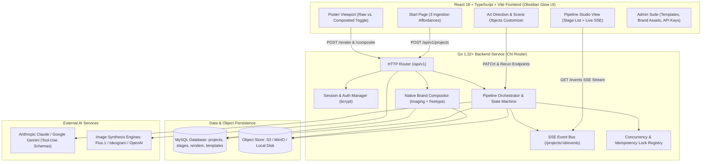
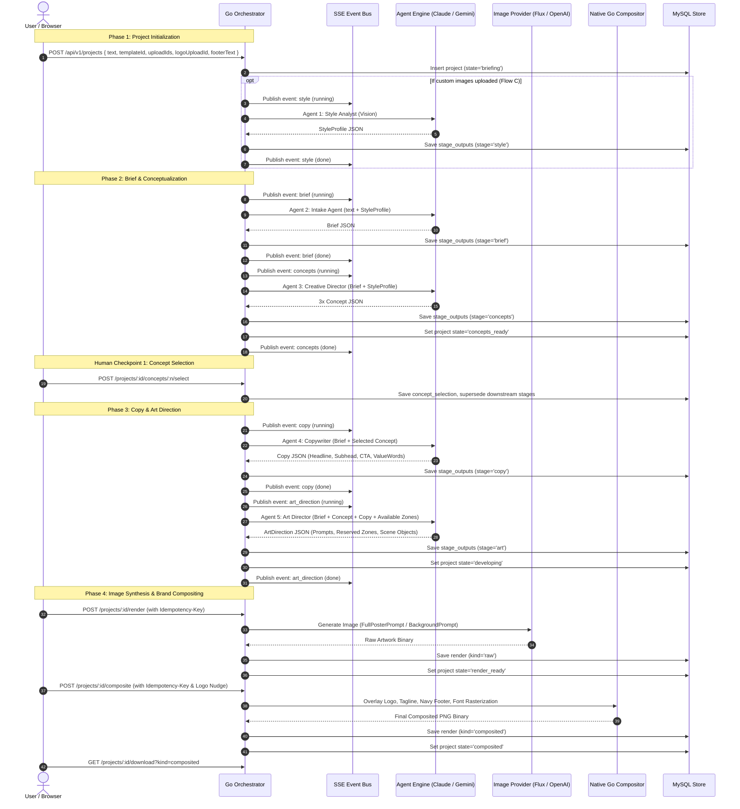
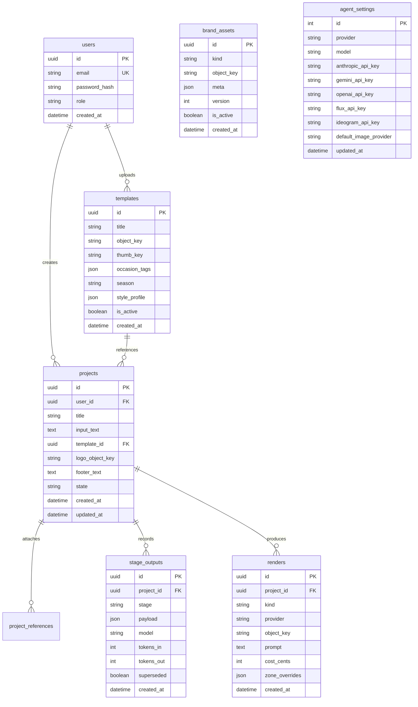

# ARMSS Poster Studio — Project Architecture & Execution Flow

> **Document Version:** 2.0  
> **Target System:** ARMSS Poster Studio (`armss_photo_studio`)  
> **Core Stack:** Go 1.22+ Backend, React 18 + TypeScript + Vite Frontend, MySQL / S3 Storage, Anthropic Claude / Google Gemini LLM Orchestrator, Flux.1 / Ideogram / OpenAI Image Engines.

---

## 1. Executive Summary & Core Engineering Principle

**ARMSS Poster Studio** is an automated creative design and production engine built for ARMSS Employment Solutions and associated organizations. It empowers non-designers (recruiters, operations staff, marketing personnel) to turn a simple occasion or event description (e.g., *"Diwali 2026 celebration for manufacturing staff"* or *"Walk-in Campus Recruitment Drive"*) into a production-ready, on-brand poster in under two minutes.

```
+-----------------------------------------------------------------------------------------+
|                                 THE CRITICAL CONSTRAINTS                                 |
|                                                                                         |
| 1. Diffusion & generative image models (Flux, DALL-E, Midjourney) inherently hallucinate |
|    vector logos, kerning, and contact numbers (e.g. producing "OARMSS" or mangled text).|
| 2. Marketing assets require pixel-exact brand fidelity and consistent typography.        |
+-----------------------------------------------------------------------------------------+
                                           │
                                           ▼
+-----------------------------------------------------------------------------------------+
|                                   THE SOLUTION ARCHITECTURE                             |
|                                                                                         |
|    AI Multi-Agent Pipeline (Creative Synthesis & Art Direction)                         |
|    - Synthesizes marketing brief, copy, layout, and visual art direction.               |
|    - Explicitly calculates & reserves clean bounding boxes (`reservedZones`).           |
|    - Renders pure background / artwork leaving brand zones uncluttered.                 |
|                                           │                                             |
|                                           ▼                                             |
|    Go Server Native Compositor (Deterministic Brand Overlay)                            |
|    - Overlays pixel-exact transparent PNG logos with alpha drop shadows.               |
|    - Renders official brand navy footer bar (`#16265A`) & vector icons.                 |
|    - Rasterizes high-clarity contact numbers via bundled TrueType fonts.               |
+-----------------------------------------------------------------------------------------+
```

---

## 2. Complete End-to-End System Architecture



---

## 3. The 3 User Ingestion Flows (Start Screen)

The application unifies three intake methods on the main start screen (`web/src/pages/StartPage.tsx`), allowing users to pick, describe, or upload references — or mix and match them.

```
       ┌─────────────────────────────────────────────────────────────┐
       │                     USER INPUT ON START                     │
       └──────┬───────────────────────┬───────────────────────┬──────┘
              │                       │                       │
              ▼                       ▼                       ▼
      [Flow A: Template]      [Flow B: Freeform]      [Flow C: Reference]
       Select pre-made         Type description        Upload 1–4 custom
       ARMSS template.         (≥ 8 characters).       poster images.
              │                       │                       │
              │                       ▼                       │
              │             [Auto-Recommendation]            │
              │             Tag matching & LLM ranks          │
              │             top 3 templates + reasons.        │
              │                       │                       │
              │             User chooses or skips             │
              │                       │                       │
              ▼                       ▼                       ▼
       Cached StyleProfile     Cached or Fallback     Agent 1: Style Analyst
       Loaded from MySQL       StyleProfile           Extracts StyleProfile
       (0 tokens spent!)       applied.               from image binaries.
              │                       │                       │
              └───────────────────────┼───────────────────────┘
                                      │
                                      ▼
                      [Optional Branding Customization]
                      - Upload custom organization logo (PNG)
                      - Enter custom organization footer contact text
                                      │
                                      ▼
                      POST /api/v1/projects Created
                      Project State: 'draft' -> 'briefing'
```

### Flow A — Pick a Template (Primary Fast Path)
1. User browses the visual gallery of approved past posters (Diwali, Pongal, New Year, Hiring Drives, Safety Announcements).
2. User clicks a template card and types the occasion/date (e.g., *"Diwali 2026"*).
3. **Cost Optimization:** Templates have their `StyleProfile` permanently analyzed and cached in MySQL. **Zero LLM tokens are spent** re-analyzing the style. The pipeline skips directly to Agent 2 (Intake).

### Flow B — Describe it & Get Smart Recommendations
1. User types an occasion description in the text box without picking a template.
2. Once input length reaches $\ge 8$ characters, debounced client-side queries `POST /api/v1/recommendations`.
3. Backend performs tag/keyword overlap matching across template metadata (occasion tags, seasons, format). If fewer than 3 match, an LLM call ranks candidate templates with clear 1-line reasons.
4. User can click any recommendation to adopt its style profile or proceed with "no reference".

### Flow C — Attach Custom Reference Images
1. User uploads 1 to 4 reference images (`image/png`, `image/jpeg`, `image/webp`).
2. Server validates images (up to 10MB) and downscales them to 1500px on the long edge to eliminate token waste.
3. System triggers **Agent 1 (Style Analyst)** on-the-fly to extract a new `StyleProfile`, stored into `project_references`.

### Custom Multi-Tenant / Client Branding
- Users are not restricted to ARMSS branding. An expandable branding drawer allows uploading a custom transparent client logo and custom footer contact text (phone, email, website).
- If omitted, default ARMSS brand assets from admin settings are applied.

---

## 4. The 7-Agent Creative Pipeline

The creative pipeline splits poster creation into discrete server-side LLM calls using strict **tool-use / function-calling schema enforcement** (`backend_anthropic.go` and `backend_gemini.go`). By avoiding freeform JSON prompting, output truncation and parsing bugs are eliminated.



---

## 5. Granular Agent Specifications & Token Budgets

| # | Agent Name | Primary Input | Strict Structured Output | Token Budget | Core Purpose & Guardrails |
|---|---|---|---|---|---|
| **1** | **Style Analyst** | Reference image binaries (downscaled 1500px) | `StyleProfile` | 4,000 | Analyzes palette hexes, typography rules, layout patterns, visual finish, and fixed furniture. Cached in DB. |
| **2** | **Intake Agent** | User prompt + `StyleProfile` | `Brief` | 4,000 | Expands short occasion text into an advertising brief. Fills missing details with culturally informed assumptions rather than blocking. |
| **3** | **Creative Director** | `Brief` + `StyleProfile` | $3 \times$ `Concept` | 4,000 | Produces 3 genuinely distinct thematic angles (Big Idea, Visual Metaphor, Emotional Mood, Palette), not shallow variations. |
| **4** | **Copywriter** | `Brief` + chosen `Concept` | `Copy` | 3,000 | Crafts tight headline, subhead, CTA, and value words. Active voice; strictly forbids exclamation marks. |
| **5** | **Art Director** | `Brief` + `Concept` + `Copy` + `StyleProfile` + available zones | `ArtDirection` | 4,000 | Produces `fullPosterPrompt`, `backgroundPrompt`, `negativePrompt`, normalized `reservedZones`, and categorized `sceneObjects`. |
| **6** | **Layout Proof** *(Diagnostic)* | `ArtDirection` | SVG Wireframe | 8,000 | Spatial check before spending image synthesis credits. |
| **7** | **Reviewer** *(QA)* | All stage outputs + rendered artwork | `Review` | 4,000 | Vision QA scoring against brief and house rules; suggests actionable fixes. |

---

## 6. Human-in-the-Loop & Downstream Invalidation (Supersede Cascade)

A core design requirement is that the pipeline is **never a black-box monolithic prompt**. Every intermediate stage is persisted in `stage_outputs` and editable in the UI. When an earlier stage changes, downstream artifacts are invalidated via a deterministic cascade:

```
                  ┌───────────────────────────────┐
                  │       Agent 2: Brief          │
                  └──────────────┬────────────────┘
                                 │
                         [Edit & Rerun Brief]
                         Invalidates Concepts, Selection, Copy, Art
                                 │
                                 ▼
                  ┌───────────────────────────────┐
                  │      Agent 3: Concepts        │
                  └──────────────┬────────────────┘
                                 │
                        [Select New Concept]
                        Invalidates Copy, Art
                                 │
                                 ▼
                  ┌───────────────────────────────┐
                  │       Agent 4: Copy           │
                  └──────────────┬────────────────┘
                                 │
                         [Manual Copy Edit]
                         Automatically re-runs Art Direction
                         to align prompts with new text!
                                 │
                                 ▼
                  ┌───────────────────────────────┐
                  │    Agent 5: Art Direction     │
                  └──────────────┬────────────────┘
                                 │
                   ┌─────────────┴─────────────┐
                   │                           │
          [Toggle Scene Objects]       [Manual Prompt Edit]
          Re-runs Art Director with    Edits prompt directly;
          excluded object list.        marks renders as stale.
                   │                           │
                   └─────────────┬─────────────┘
                                 │
                                 ▼
                  ┌───────────────────────────────┐
                  │  Renders Marked as Stale      │
                  │  (Visual Warning in Viewport) │
                  └───────────────────────────────┘
```

### Invalidation Endpoints:
1. `POST /projects/:id/brief/rerun`: Appends additional user clarification; supersedes concepts, copy, and art; re-runs Intake and Creative Director.
2. `POST /projects/:id/concepts/:n/select`: Records concept selection; supersedes copy and art; triggers Copywriter and Art Director.
3. `PATCH /projects/:id/copy`: Stores human-authored copy edit; automatically re-runs Art Director to synchronize visual prompts with modified headlines.
4. `POST /projects/:id/art-direction/rerun`: Re-runs Art Director passing user-excluded scene objects (e.g., removing a prop or element).
5. `PATCH /projects/:id/art-direction`: Direct manual edit of prompt text.

---

## 7. Reserved Zones & Deterministic Go Compositing

The Art Director outputs normalized rectangles $X, Y, W, H \in [0.0, 1.0]$ for brand furniture:

```json
{
  "reservedZones": [
    { "id": "logo", "x": 0.05, "y": 0.04, "w": 0.35, "h": 0.12, "fill": "#16265A", "note": "Clear space for client vector logo" },
    { "id": "footer", "x": 0.0, "y": 0.92, "w": 1.0, "h": 0.08, "fill": "#16265A", "note": "Solid contact footer bar" }
  ]
}
```

### The Compositor Engine (`internal/compositor/compositor.go`):
1. **Dynamic Zone Filtering:** If a project does not supply a footer string or logo, the Art Director is instructed **not** to reserve those zones, preventing blank color patches from baking into the AI art.
2. **Coordinate Mapping:** Transforms normalized floats to exact pixel bounding boxes based on the generated image canvas dimensions ($W \times H$).
3. **Layer 1: Navy Footer Bar:** Draws a solid rectangle in Brand Navy (`#16265A`), overlays phone/web icons, and rasterizes the contact string with bundled TrueType fonts using `golang/freetype`.
4. **Layer 2: Tagline Lockup:** Draws official company tagline vector asset if active.
5. **Layer 3: Brand Logo:** Scaled with bilinear filtering (`imaging.Fit`) preserving aspect ratio, centered in its zone, and overlaid with a soft Gaussian alpha drop shadow.
6. **Real-Time Nudge Controls:** Users can adjust Offset X and Offset Y coordinates in the UI and re-composite instantly without incurring image generation fees.

---

## 8. Multi-Provider AI Architecture & Cost Economics

The platform abstracts both text LLMs and image diffusion models behind pluggable interfaces:

```
                           ┌───────────────────────────┐
                           │    BACKEND ROUTING HUB    │
                           └─────────────┬─────────────┘
                                         │
                 ┌───────────────────────┴───────────────────────┐
                 │                                               │
                 ▼                                               ▼
     [LLM Backend Orchestrator]                     [Pluggable ImageRegistry]
     - Anthropic Claude 3.5 Sonnet                  - Flux.1 (Replicate / BFL)
     - Google Gemini 2.5 Flash / 1.5 Pro              * Cost: ~$0.003/img (90% savings)
     - Dynamic runtime swapping via Admin UI          * Best for: Jewelry, lighting, glow
     - Tool-use schema validation                   - Ideogram v2
                                                      * Cost: ~$0.08/img
                                                      * Best for: 3D typography
                                                    - OpenAI DALL-E 3
                                                      * Cost: ~$0.08/img
                                                      * Best for: General illustration
```

### Billing & Safety Guardrails:
- **Idempotency Keys:** Every render and composite request requires a unique client-generated UUID in the `Idempotency-Key` header to protect against network retries double-billing the user.
- **Hardware-Level Mutex Locks:** Concurrency registry prevents simultaneous duplicate renders on the same project.
- **Explicit User Action:** Image generation is strictly gated behind an explicit button press; the system never auto-renders images.

---

## 9. Database Entity Model (MySQL)



---

## 10. HTTP API Route Directory

All routes are mounted under `/api/v1` with JSON request/response formats and Server-Sent Events:

| Method | Endpoint | Access | Description |
|---|---|---|---|
| `POST` | `/auth/login` | Public | Authenticates user; issues secure session cookie. |
| `POST` | `/auth/logout` | Authenticated | Terminates active user session. |
| `GET` | `/auth/me` | Authenticated | Returns currently authenticated user context and role. |
| `GET` | `/templates` | Authenticated | Lists active poster templates with occasion filters. |
| `GET` | `/templates/:id` | Authenticated | Retrieves single template details and cached style profile. |
| `POST` | `/templates` | Admin | Uploads new reference image, runs Style Analyst, creates template. |
| `PATCH` | `/templates/:id` | Admin | Updates template metadata or manual style profile adjustments. |
| `POST` | `/templates/import-starter-library` | Admin | Seeds predefined festival & corporate template library. |
| `GET` | `/brand-assets` | Authenticated | Returns active logo, tagline, and footer configurations. |
| `PUT` | `/brand-assets` | Admin | Replaces brand asset files with new version. |
| `POST` | `/uploads` | Authenticated | Uploads user reference or custom logo image. |
| `POST` | `/recommendations` | Authenticated | Recommends 3 templates based on user occasion prompt. |
| `POST` | `/projects` | Authenticated | Initializes project, triggers Intake and Creative Director. |
| `GET` | `/projects` | Authenticated | Lists current user's poster projects. |
| `GET` | `/projects/:id` | Authenticated | Fetches full project status, all stage outputs, and renders. |
| `GET` | `/projects/:id/events` | Authenticated | **SSE Stream:** Real-time stage progress (`running`, `done`, `error`). |
| `POST` | `/projects/:id/brief/rerun` | Authenticated | Appends clarification, supersedes downstream, re-runs brief. |
| `POST` | `/projects/:id/concepts/:n/select` | Authenticated | Selects 1 of 3 concepts, triggers Copywriter and Art Director. |
| `PATCH` | `/projects/:id/copy` | Authenticated | Manually updates copy; automatically refreshes Art Direction. |
| `PATCH` | `/projects/:id/art-direction` | Authenticated | Manually edits prompt texts or aspect ratio. |
| `POST` | `/projects/:id/art-direction/rerun` | Authenticated | Re-runs Art Director excluding unselected scene objects. |
| `POST` | `/projects/:id/render` | Authenticated | Generates raw poster artwork via chosen image provider. |
| `POST` | `/projects/:id/composite` | Authenticated | Composites logos, tagline, and footer bar onto artwork. |
| `GET` | `/projects/:id/download` | Authenticated | Downloads raw or composited poster image file. |
| `GET` | `/agent-settings` | Admin | Returns configured LLM provider, active models, and key masks. |
| `PUT` | `/agent-settings` | Admin | Updates active LLM engine and default image provider. |
| `PUT` | `/agent-settings/keys` | Admin | Securely stores provider API keys. |

---

## 11. Summary of Benefits & Differentiators

1. **Brand Protection Guarantee:** Brand assets are never passed to the image generator; they are deterministically composited on the server.
2. **Cost Sizing & Efficiency:** Style profiling is cached permanently per template; Flux.1 engine delivers quality visual generation at ~$0.003 per run (90% savings over older engines).
3. **Human-in-the-Loop Flexibility:** Every step (brief, concepts, copy, scene objects, prompts, logo coordinates) is editable, with smart automatic downstream regeneration.
4. **Reliability:** Built with Go concurrency locks, client idempotency keys, and tool-use schema enforcement to prevent duplicate billing and malformed JSON errors.
